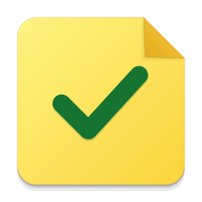

# Real Sticky Note

A Windows desktop app for notes that stay in sight until the work is done. Each floating note is a real, always-on-top window. Close the board and your notes keep floating; restart the app and they return.

## Run the app

Open `release/Real Sticky Note Setup 0.1.0.exe` to install for your Windows account. Or open `release/win-unpacked/Real Sticky Note.exe` directly. Keep the entire `win-unpacked` folder together. Windows 10/11 x64; no administrator access required. The installer is unsigned, so Windows may show a publisher warning.

For development, with Node.js 24 installed:

```powershell
npm ci
npm start
```

Electron downloads its runtime on first use. The development launcher clears `ELECTRON_RUN_AS_NODE` so it also works inside Electron-based coding tools.

## Use it

Press **Ctrl + Shift + T** from any app to capture a note. Choose Checklist and put one item on each line. Click **Stick note**. Check items on the floating note; checking the last item completes the note automatically. An unfinished checklist cannot be completed with a separate Crush action.

Drag a note by its top bar, or resize its edges. The board's pin button brings a floating note forward. **Crushed** contains completed notes; **Ashes** contains notes you set aside. **Revive** brings either back; **Undo** reverses recent note changes during the current session.

The tray icon opens the board and its right-click menu provides hiding, capture protection, ghost release, settings, and Quit. Closing the board keeps the app running. Use **Ctrl + Shift + Space** to toggle the board.

### More tools

- Six paper colors and six boards, search, due dates, and daily or weekly repeats.
- Focus timers on each floating note, with a countdown, a Windows notification, and a five-minute extension.
- Crush, toss, shred, and ash animations with optional generated paper sounds.
- App notes: switch to the target app, reopen the board, and select **Pin to [app]** while creating a note. The monitor button on a floating note binds or unbinds it. Bound notes follow that app's foreground window, hide when you switch apps, and optionally tuck into a hover tab.
- Ghost mode: the ghost button makes a note translucent and click-through. Hold **Alt** to interact; **Ctrl + Alt + G** releases all ghost notes. The tray menu provides the same recovery action.
- Private notes and global capture protection request exclusion from supported Windows screen captures. Automatic protection during microphone use reads Windows activity status, without recording audio.
- Daily Wrap: per-day autosaved journal, win, tomorrow's task, mood, completed notes, and focus minutes. Export a portrait or wide PNG card. Uncheck notes you want to keep off the card; private notes start unchecked.
- Saved Links keeps a separate permanent reading list. Optional Link Catcher turns copied public web URLs into Reading notes, removes common trackers, and ignores concealed clipboard formats and common credential parameters. It never fetches page titles or icons.
- Optional morning and evening prompts, launch at sign-in, JSON backup export, and backup import that merges new entries.

### Daily Burn

Daily Burn is **off by default**. If enabled, old undated plain notes move to Ashes after midnight, including when the app restarts after several days. Checklists, dated notes, and repeating notes stay safe. Nothing in Ashes is automatically deleted.

### URL commands

The installed app registers `realsticky://`. Examples:

```text
realsticky://add?text=Buy%20milk&board=Personal
realsticky://plan
realsticky://crush?text=milk
realsticky://focus?minutes=25&text=report
realsticky://wrap
realsticky://privacy?on=1
```

## Storage and privacy

Notes are plain local JSON under the app's Windows roaming application-data directory. **Settings → Open data folder** opens the exact location. `notes.json.bak` stores the previous valid save. Writes use a flushed temporary file and atomic rename. If the primary file is corrupt, the app preserves it and tries the backup; if both are unreadable it stops rather than replacing your notes. Export regular backups for important information.

No account, telemetry, cloud service, update checker, or background web requests. Links open in your default browser only when you click them. Local JSON is not encrypted. Link Catcher and launch at sign-in are opt-in. The Windows foreground helper runs hidden and needs no administrator privileges.

## Verification

```powershell
npm test
npm run test:desktop
npm run test:edges
npm run build
```

The desktop test launches real Electron windows with temporary, isolated data, restarts them, and exercises the checklist, persistence, ghost controls, journal, link archive, backup, and PNG export flows. `test:edges` verifies rollover protections, recurrence, timer expiry, visibility, card exclusions, and link ingestion. It explicitly reports whether native clipboard access is available or uses injected ClipboardItem input. See [verification details](docs/verification.md).

To run the desktop suite against the packaged executable:

```powershell
$env:STICKY_EXECUTABLE = (Resolve-Path 'release/win-unpacked/Real Sticky Note.exe').Path
npm run test:desktop
Remove-Item Env:STICKY_EXECUTABLE
```

## Scope and limitations

This is an independent implementation inspired by [CrushPaper](https://crushpaper.pages.dev/), with original code, icon, and sounds. No public source repository or open-source license was located. It uses its own name and URL scheme. It reproduces the core workflow; it is not a pixel-exact port of the macOS app or its proprietary paper physics, Dock Trash targeting, Liquid Glass, Raycast integration, or auto-updater. Electron's runtime also makes it much larger than the native Mac app.

Topmost windows work over normal desktop apps and borderless fullscreen apps. Exclusive fullscreen rendering, UAC screens, protected desktops, capture protection, microphone status, and app pinning depend on Windows and the other application. Capture protection is a request and cannot guarantee secrecy across all recording tools. Microphone activity and foreground app switching require final validation in your interactive Windows session; the automated session has no usable system clipboard or foreground window. Per-note Windows focus and screen-sharing behavior should be tried with your actual apps before relying on it.

Repeat completion creates the next dated note immediately; it does not wait until that date to appear. Board categories are fixed in this version. Focus minutes count finished timer sessions. Undo history is session-only, and checkboxes reset on Revive. There is no permanent-delete or sweep action, so saved material remains recoverable.
